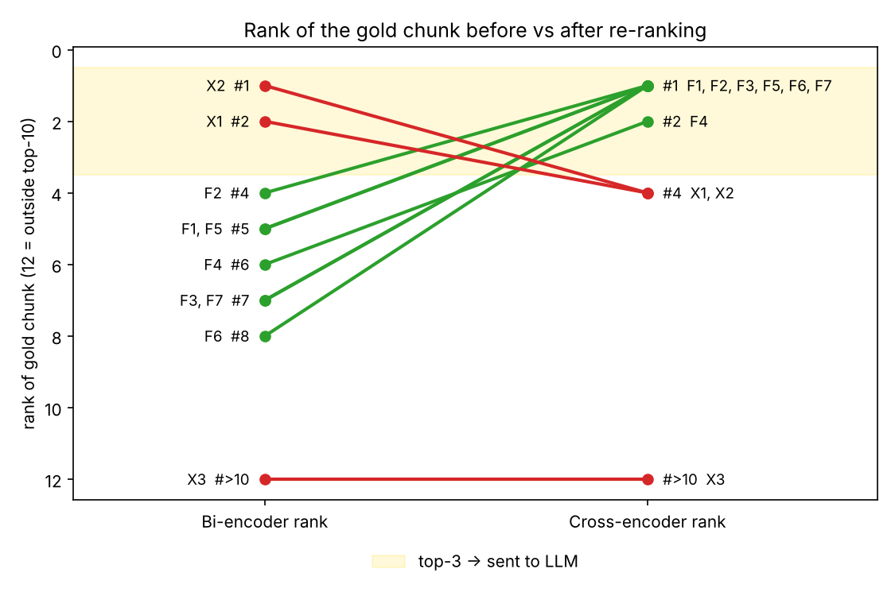

# RAG: Baseline Bi-Encoder vs. Cross-Encoder Re-Ranking

Two-stage retrieval experiment over a single complex PDF, the **FIDE Arbiters' Manual 2026** (Laws of Chess with commentary, rapid/blitz rules, fair-play, Swiss pairing, rating/title/tie-break and online-chess regulations).

* **Pipeline 1 (baseline):** `all-MiniLM-L6-v2` embeddings in FAISS → top-10 by cosine → top-3 → LLM → *Answer 1*
* **Pipeline 2 (re-rank):** same top-10 → `cross-encoder/ms-marco-MiniLM-L-6-v2` → re-sorted top-3 → same LLM and prompt → *Answer 2*

## Headline results (28 questions, gold clause = verbatim answer text)

| | Hit@1 | Hit@3 | MRR@10 | Recall@10 | Median retrieval latency |
|---|---|---|---|---|---|
| Baseline | 0.393 | 0.536 | 0.521 | 0.893 | 6.8 ms (GPU) |
| Re-ranked | **0.679** | **0.821** | **0.762** | 0.893 | 40.9 ms (GPU) |

All 7 stress-test queries (keyword traps, exceptions, negations, buried chunks) had the answering chunk at bi-encoder rank 4–8. Re-ranking moved it into the top 3 (to #1 in six). With the same generator (Qwen2.5-1.5B), the baseline answered **0/7** stress tests fully correctly and the re-ranked pipeline **4/7**. Three counter-examples show where re-ranking hurts or cannot help. Details are in **[REPORT.md](REPORT.md)**.



## Repository layout

```
RAG_Baseline_vs_Reranking.ipynb   ← all code, step by step, with comments
REPORT.md                         ← the written report (architecture, rank shifts, answers, latency, scaling)
data/Arbiter-Manual-2026.pdf      ← the source document
results/                          ← CSVs, figure, and LLM answers written by the notebook
```

## Running it

1. Open the notebook in Google Colab (GPU runtime recommended).
2. *Runtime → Run all*. The first cell clones this repo if the PDF isn't present. Answers are generated locally by `Qwen/Qwen2.5-1.5B-Instruct`, so no API key is needed.

Optional environment variables: `LLM_BACKEND` (`hf` default | `gemini` with a `GEMINI_API_KEY` secret | `none`), `GEMINI_MODEL`, `LOCAL_MODEL_DIR` (load the two encoders from a local folder).
